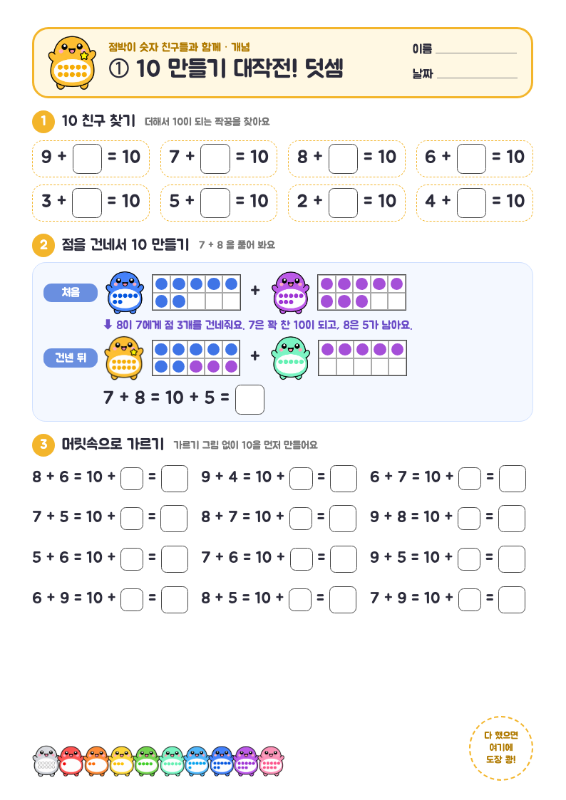
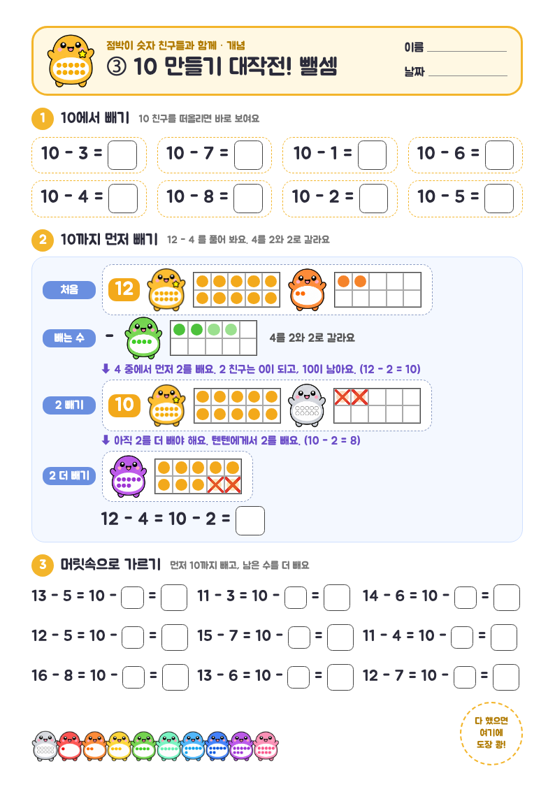
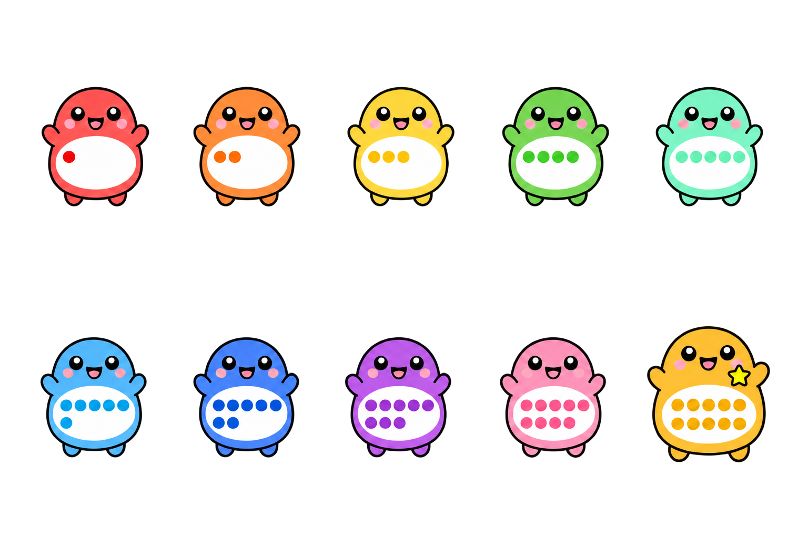

# 점박이 숫자 친구들 - 무료 수학 학습지

초등학생 부모님과 선생님이 **무료로 만들어 인쇄해 쓸 수 있는** 수학 학습지입니다.
오리지널 캐릭터 "점박이 숫자 친구들"이 개념을 그림으로 보여 줍니다.

| 덧셈 개념 | 뺄셈 개념 |
|---|---|
|  |  |

## 바로 인쇄하기

[`examples/10making_sample.pdf`](examples/10making_sample.pdf)를 내려받아 A4로 인쇄하세요. (6장, 마지막 장은 정답지)

## 지금 있는 학습지

### 10 만들기 대작전 (1학년, 받아올림 덧셈·받아내림 뺄셈)
7+8, 12-4 같은 계산을 손가락 없이 바로 떠올리도록 연습합니다.

1. 덧셈 개념: 10 친구 찾기, 점을 건네서 10 만들기, 머릿속 가르기
2. 덧셈 36문제: 받아올림 덧셈 전부
3. 뺄셈 개념: 10에서 빼기, 10까지 먼저 빼기, 머릿속 가르기
4. 뺄셈 36문제: 받아내림 뺄셈 전부
5. 섞어서 40문제
6. 정답지

## 새 학습지 만들기 (문제 순서 바꾸기)

필요한 것: Python 3, Google Chrome

```bash
cd worksheets
python3 build.py 20261124      # 숫자(seed)를 바꾸면 2·4·5장의 문제 순서가 바뀝니다
```

결과는 `worksheets/out/` 에 PDF로 생깁니다. 매일 숫자를 바꿔 한 장씩 풀면 반복 연습이 됩니다.
macOS가 아니면 Chrome 경로를 지정하세요: `CHROME=/usr/bin/google-chrome python3 build.py 1`

## 캐릭터: 점박이 숫자 친구들



- 0~10의 젤리 몬스터. 배에 자기 숫자만큼 점이 10칸 상자 모양(5개씩 2줄)으로 있습니다.
- 10은 대장 "텐텐"(10 묶음). 더하기는 점을 건네주고, 빼기는 점에 ×를 칩니다.
- 개별 그림: `assets/chars/`, 설정 시트(앞·옆·뒤·위·아래, 표정): `assets/turnaround/`
- 앞으로 1~6학년 수학 전체로 넓혀 갈 예정입니다. (백·천, 분수, 소수, 도형, 측정)

## 라이선스

[CC BY-NC-SA 4.0](LICENSE)

- **가정, 교실, 비영리 목적은 무료**로 쓰고, 인쇄하고, 고치고, 나눠도 됩니다.
- 쓸 때는 출처(이 저장소)를 밝혀 주세요. 고쳐서 나누는 것도 같은 라이선스로 공개해야 합니다.
- **상업적 이용(학원 교재, 출판, 유료 판매, 유료 서비스 포함 등)은 안 됩니다.**
  상업적으로 쓰고 싶다면 별도 계약(이용료)이 필요합니다. [이슈](../../issues)에 "상업적 이용 문의"로 남겨 주세요.

## 의견과 기여

- 오류 제보, 학습지 아이디어, 상업적 이용 문의는 [이슈](../../issues)로 받습니다.
- **Pull Request는 받지 않습니다.** 자세한 내용은 [CONTRIBUTING.md](CONTRIBUTING.md)를 봐 주세요.
